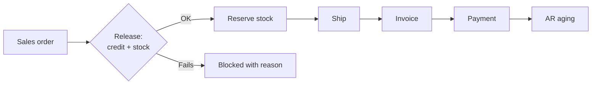

# Northfield ERP: an order-to-cash implementation case study

[](https://github.com/adham-abdalla/northfield-erp/actions/workflows/tests.yml)


**▶ Live demo: [adham-abdalla.github.io/northfield-erp](https://adham-abdalla.github.io/northfield-erp/)**

A working **ERP order-to-cash** prototype modelled on **Microsoft Dynamics 365 Business Central**, with the documents an implementation team produces: requirements, a fit-gap analysis, a configuration workbook, and a full test plan with results.

The client, *Northfield Office Supply*, is a fictional wholesale distributor that re-types orders between spreadsheets, sells items it doesn't have in stock, and finds overdue invoices too late.

---

## 🔄 The process it covers



| Step | What the system checks or does |
|---|---|
| **Order** | Valid quantities, discount 0–25%, 13% HST, blocked customers can't order |
| **Release** | Credit limit (owing + on order + this order) and stock for **every** line; reserves stock all-or-nothing |
| **Ship** | Reduces stock and writes an **item ledger** entry (audit trail) |
| **Invoice** | Due date from payment terms (COD, NET15, NET30, NET45), numbered INV-1001… |
| **Payment** | Partial payments; overpayment blocked; status Open / Partly paid / Overdue / Paid |
| **Reports** | AR aging (Current, 1–30, 31–60, 61–90, 90+), reorder suggestions, sales and margin |

## 📁 Project documents

| # | Document | What it shows |
|---|---|---|
| 01 | [Brief and Requirements](docs/01-brief-and-requirements.md) | Client problem, to-be process, 10 requirements with acceptance criteria |
| 02 | [Fit-Gap and Solution Design](docs/02-fit-gap-and-design.md) | Comparison with Business Central, data model, status rules, **configuration workbook** |
| 03 | [Testing](docs/03-testing.md) | Test plan, 35 test cases with results, traceability matrix, defects |

## 💡 Design decisions worth noting

- **All-or-nothing posting:** every operation works on a copy of the data and only saves if all checks pass, the way an ERP posts in a database transaction. TC-10 checks the data is unchanged after a failure.
- **Money in cents:** $8.99 is stored as `899`, so totals are always exact (no `0.1 + 0.2` floating-point errors).
- **Append-only ledger:** stock movements are only ever added, never edited, which gives a full audit trail.
- **Honest fit-gap:** Business Central only *warns* on credit limits by default. The analysis recommends an approval workflow instead of custom code.

## ✅ Testing

**21 automated tests** plus **14 user acceptance tests**, all passing. The automated tests run on every push with GitHub Actions.

```bash
npm test        # Node.js 20+, no packages to install
```

## 🛠 Run it locally

```bash
git clone https://github.com/adham-abdalla/northfield-erp.git
cd northfield-erp
npx serve .     # or: python -m http.server 8000
```

## 🗂 Structure

```
├── index.html           App shell
├── css/styles.css
├── js/
│   ├── engine.js        Posting engine: orders, stock, invoices, payments, reports
│   ├── store.js         Saves data; runs every change as a transaction
│   ├── seed.js          Sample history, created through the engine
│   └── app.js           Screens and forms
├── tests/               Automated tests (node:test)
└── docs/                Requirements, fit-gap and design, testing
```

## 🎯 Skills demonstrated

ERP business processes (order-to-cash, inventory, receivables) · Dynamics 365 Business Central fit-gap and configuration · requirements and acceptance criteria · test planning, boundary testing and traceability · JavaScript with separated business logic · CI with GitHub Actions

## 🚀 Next steps

- [ ] Rebuild in a **Business Central** sandbox (free trial) using the configuration workbook
- [ ] Add purchase orders (procure-to-pay) and sales returns
- [ ] Power BI report on sales and receivables

---

Built by **Adham Abdalla** · [GitHub](https://github.com/adham-abdalla) · See also: [Harbourline CRM](https://github.com/adham-abdalla/harbourline-crm) · [MIT License](LICENSE)
