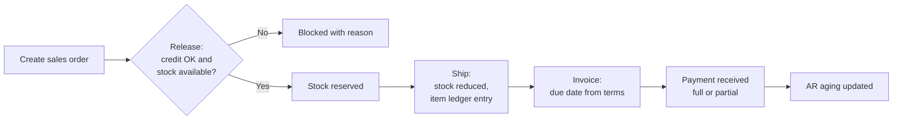

# 01 · Client Brief and Requirements

> **Note:** Northfield Office Supply is a fictional client created for this case study.

## The client

**Northfield Office Supply** is a wholesale distributor in Southern Ontario with 18 staff. It sells paper, toner, furniture and stationery to offices, schools and clinics on credit terms.

| Today | Problem |
|---|---|
| Orders typed into a spreadsheet, then re-typed into the accounting system | Double entry and typing errors |
| Stock counted by hand once a month | Orders accepted for items that are out of stock |
| No credit check | Some customers owe far more than the business is comfortable with |
| Overdue invoices found by scrolling through a list | Collections start late and cash flow suffers |

**Goal:** one system for the full **order-to-cash** process: take the order, check credit and stock, ship, invoice, collect payment and see who owes what.

## Order-to-cash process (to-be)

## Functional requirements

| ID | Requirement | Acceptance criteria | Priority |
|---|---|---|---|
| REQ-01 | Customer master | Name, city, payment terms (COD, NET15, NET30, NET45) and credit limit required. Blocked customers can't place orders. | Must |
| REQ-02 | Item master and stock | SKU 3–20 capitals, numbers or dashes, and unique. Price above 0; cost can't exceed price. Reorder point and quantity. Receiving stock increases on hand and is logged. | Must |
| REQ-03 | Sales orders | At least one line; whole-number quantities above 0; line discount 0–25%; 13% HST; numbered SO-1001, SO-1002… | Must |
| REQ-04 | Stock check and reservation | Release only if **every** line has enough available stock (on hand − reserved). Release reserves the stock. If any line is short, nothing is reserved. | Must |
| REQ-05 | Credit check | Release is blocked if unpaid invoices plus released or shipped orders plus this order exceed the credit limit. | Must |
| REQ-06 | Shipping | Only released orders can ship. Shipping reduces on hand and reserved, and writes an item ledger entry. | Must |
| REQ-07 | Invoicing | Only shipped orders can be invoiced. Due date = invoice date + payment terms. Numbered INV-1001… | Must |
| REQ-08 | Payments | Partial payments allowed; payment can't exceed the balance; invoice shows Open, Partly paid, Overdue or Paid. | Must |
| REQ-09 | AR aging report | Unpaid balances per customer in buckets Current, 1–30, 31–60, 61–90 and 90+ days past due, with totals. | Must |
| REQ-10 | Dashboard and reorder list | Sales and gross margin this month, receivables, overdue amount, orders waiting for the next step, and suggested reorder quantities. | Should |

## Non-functional requirements

| ID | Requirement |
|---|---|
| NFR-01 | **All-or-nothing posting:** if any check fails, no data changes. |
| NFR-02 | **Exact money:** amounts stored in cents (whole numbers), so there are no rounding errors. |
| NFR-03 | **Audit trail:** stock movements are only ever added to the item ledger, never edited. |
| NFR-04 | Works on desktop and phone screens; clear error messages that say what to fix. |
| NFR-05 | Automated tests run on every change (GitHub Actions). |

## Out of scope
Purchase orders and vendor bills, multiple warehouses, returns and credit memos, the general ledger, and bank reconciliation. These are covered by standard Business Central features in a later phase.

Next: [02 · Fit-Gap and Solution Design](02-fit-gap-and-design.md)
