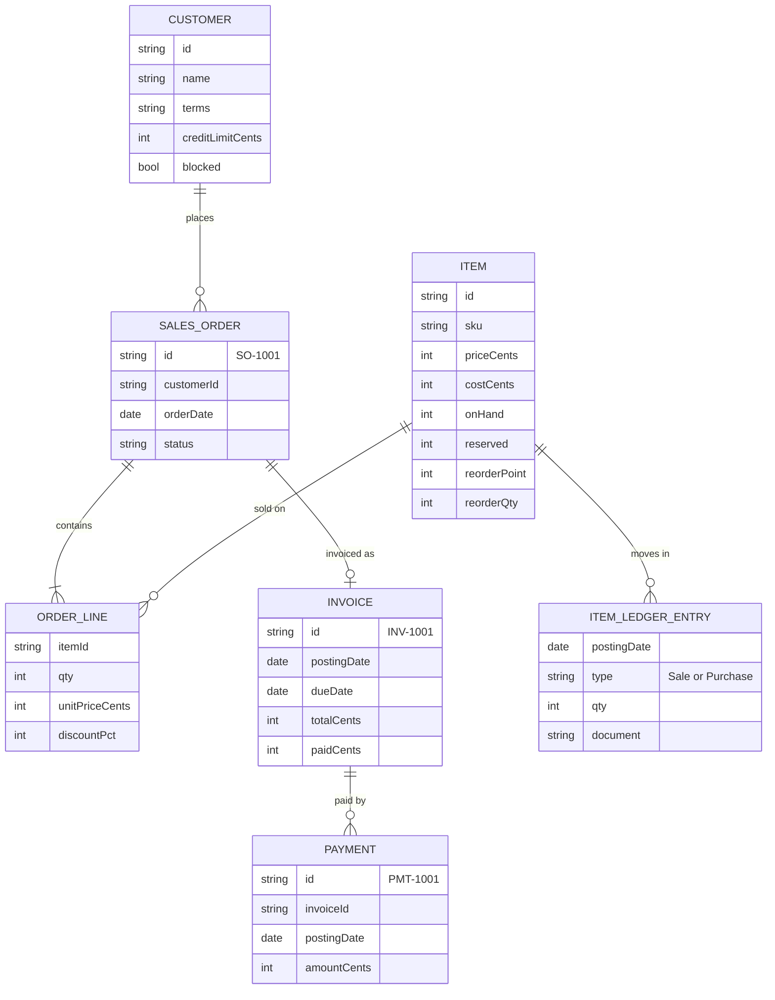
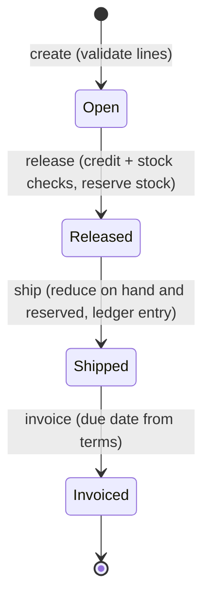

# 02 · Fit-Gap Analysis and Solution Design

## 1. Fit-gap against Dynamics 365 Business Central

**Fit** = standard feature · **Configure** = setup only · **Extend** = needs an extension (AL code) or a Power Automate flow

| Req | Requirement | Business Central feature | Result | Notes |
|---|---|---|---|---|
| REQ-01 | Customer master | Customer card: Payment Terms Code, Credit Limit (LCY), Blocked | Fit | Set up the payment terms codes COD, NET15, NET30, NET45 |
| REQ-02 | Items and stock | Item card, Reorder Point, Reorder Quantity, Item Ledger Entries | Fit | SKU rules enforced through a naming convention and data review |
| REQ-03 | Sales orders | Sales Order, Line Discount %, No. Series | Configure | No. Series `SO`, `INV`; Canadian sales tax through Tax Areas and Tax Groups (13% HST) |
| REQ-04 | Stock check and reservation | Stockout warning, Reserve action, Reserve = Always | Configure | **Difference:** BC warns on stockout by default. Setting "Prevent Negative Inventory" plus Reserve = Always gives the same behaviour as the prototype |
| REQ-05 | Credit check | Credit Warnings in Sales & Receivables Setup | Configure / **Extend** | BC shows a **warning** by default. A hard stop needs an approval workflow (Power Automate or BC approvals) or a small extension |
| REQ-06 | Shipping | Post Ship | Fit | Creates item ledger entries automatically |
| REQ-07 | Invoicing | Post Invoice, due date from Payment Terms | Fit | |
| REQ-08 | Payments | Cash Receipt Journal, Apply Entries | Fit | Partial payments leave the remaining amount open |
| REQ-09 | AR aging | Aged Accounts Receivable report | Fit | Aging by due date, 30-day periods |
| REQ-10 | Dashboard and reorder | Role Centre KPIs; Requisition Worksheet / Planning | Configure | Use the Business Manager or Order Processor role centre |
| NFR-01 | All-or-nothing posting | Posting routines run in database transactions | Fit | |
| NFR-03 | Audit trail | Ledger entries can't be edited or deleted | Fit | |

**Summary:** 8 Fit · 3 Configure · 1 Configure/Extend · 0 Gap.
**Recommendation:** use standard BC with configuration. For REQ-05, start with an **approval workflow** for orders over the credit limit rather than custom code. That keeps the solution upgrade-safe.

## 2. Data model

## 3. Order status rules

Any other move (for example, shipping an Open order) is rejected with a message.

## 4. Configuration workbook (what would be set up in Business Central)

| Setup area | Value |
|---|---|
| No. Series | SO-1001 (sales orders), INV-1001 (posted invoices), PMT-1001 (payments), RCPT-1001 (receipts) |
| Payment Terms | COD = 0 days, NET15 = 15, NET30 = 30, NET45 = 45 |
| Sales tax | Tax Area `ON`, HST 13% |
| Sales & Receivables Setup | Credit Warnings = Credit Limit; Stockout Warning = on |
| Inventory Setup | Prevent Negative Inventory = on |
| Line discount | Maximum 25% (approval needed above this) |

## 5. Application design

| File | Responsibility |
|---|---|
| `js/engine.js` | Posting engine: every operation copies the data, runs all checks, and returns the new data only if everything passes (NFR-01) |
| `js/store.js` | Saves to browser storage; the screen never changes data directly |
| `js/seed.js` | Builds the sample history by running real transactions through the engine |
| `js/app.js` | Screens, forms and actions |

**Why cents?** `0.1 + 0.2` is `0.30000000000000004` in JavaScript. Storing $8.99 as `899` keeps every total exact. The test TC-03 checks this.

Next: [03 · Testing](03-testing.md)
